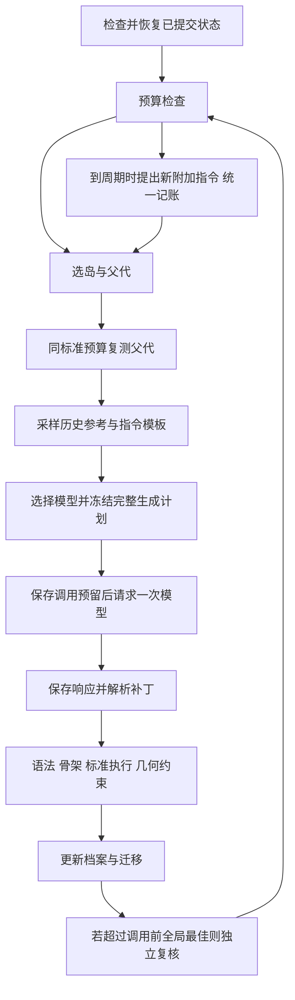

# 可持续运行的代码进化智能体

更新：2026-11-12。当前框架清单为 schema 9。此前的实验和 comparisons/selection_plan_v1 保留作历史记录；新代码需要新建实验/匹配计划，不能修改旧清单绕过版本检查。

本轮补齐了 P6 历史上下文、P7 串行有限预算循环、P8 同预算自动复核、P9 模型路由，以及 P10 附加指令演化的首版。另提供多个独立实验的有界异步批处理和第二个装箱任务。现在另有同一实验内的本机有界异步流水线首版，见 [async_pipeline.md](async_pipeline.md)。它不是跨机分布式系统，也没有产生正式的论文复现结论。

## 先运行离线完整演示

在 D:\Evolve-Agent 中运行：

```powershell
python -X utf8 -m Examples.run_search --config configs/circle_packing.offline.json --offline-demo
```

这个配置最多6代，使用PUCT、两岛、历史参考程序、自动复核和元指令尝试。响应来自已经审查过的本地手写夹具；程序真实执行、固定评测器真实验证、记录真实落盘。没有构造远程模型客户端，不需要密钥，没有真实API费用。

夹具会在简单网格与25圆网格加孔隙圆之间切换，可能得到2.541421左右的人工布局。它用于验证链路，不能当成模型重新发现算法，不能据此比较三种选择器质量。出现不同父代、格子、参考数量是策略状态变化的正常结果。

控制器达到生成预算、调用/token/评测时间/累计墙钟预算，或 STOP 文件/本次 steps 上限时停止。输出控制记录与用量；再次打开同一实验可继续剩余预算。有限预算停止不是异常，也不会自动扩充实验预算。

```powershell
python -X utf8 -m Examples.run_search --experiment dev_runs/exp_实际编号 --offline-demo --steps 2
python -X utf8 -m Examples.inspect_archive --experiment dev_runs/exp_实际编号
```

每次不带 `--experiment` 都是从头新建实验；`--steps` 仅限制本次启动新增的代数，不放宽清单中的总预算。恢复已有响应不算新生成次数，但仍执行必要的、尚未完成的评测并消耗评测预算。

## 数据如何流动



父代是补丁对象。参考程序只提供灵感：第一份优先高分，后续优先不同特征格，再按固定随机种子选择。只读取当时已经提交的合法 search 结果；同源代码不重复加入提示词，整份源码装不下则跳过。参考检索去重不等于候选数据库去重，也没有宣称AST语义去重。

任务、父代完整代码、固定协议和本次改进指令必须全部放得下，否则拒绝发请求。可选的任务包 references.md 会进入实验快照，最多取配置字节数，并记录截断/哈希；注入已知好布局时必须披露人工先验。父代日志也限长并记录实际来源评测。参考/日志/附加指令作为数据，不具备修改固定评测和骨架的权限；这不构成执行安全隔离。

生成计划保存 context、inspiration_ids、prompt_template_id、模型路由及完整消息。选择前的历史成绩、本次父代复测、参考程序的成绩各有独立ID，不混成一个“历史最好”。

## 配置与预算

新增可选配置会在创建实验时展开默认值，并冻结到 manifest。主配置 configs/circle_packing.json 已列出全部字段。

| 区域 | 默认值/用途 |
|---|---|
| context | 最多2份参考、60000字节总消息、8000字节材料、1500字节父代日志；两个加权指令模板 |
| budget.max_calls | 100次模型调用，包含程序与元指令，失败也计入 |
| budget.max_tokens | 1000000；请求前预留输入估计+最大输出，返回后使用报告用量 |
| budget.max_evaluation_seconds | 3600秒；搜索与confirmation都计入，开始前预留完整执行窗口 |
| budget.max_wall_seconds | 7200秒；控制器各次运行累计；下一次模型请求预留120秒窗口 |
| routing.models | 空列表时使用原model配置；非空时按权重选择服务/型号 |
| confirmation | 默认关闭；启用后对超过本次调用前全局最佳的子代重复3次 |
| meta | 默认关闭；启用后每10条完成链提出附加指令，用前3次完成使用报告信用 |

用量保存在独立 calls 账本。调用成功、被拒绝或结果未知都保留计划与状态；不因响应解析失败退回调用额度。没有usage或服务结果未知时，用原预留量保守记账并标注未知，不算0成本。程序请求与元指令请求共用预算，不存在额外的“免费”修复或元提示词调用。

输入token预留采用UTF-8字节数加消息封装余量，是可检查的保守估计，不是中转服务tokenizer的数学上界。提供方报告用量超过预留时按实际值记账并阻止后续超支，无法追溯撤回已发生用量。请求超时120秒，失败/清理/OS调度仍可能使墙钟预算短时超出，因此预算是发起前的准入规则，不冒充硬实时或平台账单保证。

中断控制器未能保存结束时间时，恢复保守地把开始至恢复的全部时间计入，可能连停机时间也多算；不会静默重置墙钟预算。未知模型调用阻止自动续跑；已有已提交响应可恢复，绝不重发。人为判断要另开新尝试时必须明确记录新身份，不能改旧调用为成功或0费用。

默认没有货币估算。要开启参考费用上限，必须同时填写 input_cost_per_million、output_cost_per_million、price_source（含来源/日期）和 max_estimated_cost。多模型时这套统一费率须采用覆盖全部路由的保守参考上限，否则不适合作为准入额度；它不是各提供方的实际账单。真实费用需要平台账单核验。

## 自动复核与评测级联

当前级联为：补丁解析 → 语法/骨架 → 完整标准预算执行及约束 → 可选独立复核。没有把3秒程序强行放到0.5秒初筛，以免把内部按时间停止的有效算法全部误判超时。

`confirmation.enabled=true` 时，子代必须合法且分数超过生成计划保存的 best_score_before + min_improvement 才触发。仍用相同标准预算，每次有独立评测记录；统计采用 all-valid-median-v1，搜索档案不使用confirmation结果。得分很高但复核不稳定时会在组的合法率和波动中显现，不自动改写搜索奖励。

复核组ID先保存到生成状态，再运行评测。中断后已有完整组直接复用；部分组保留已有结果并停止自动续跑，不静默补跑或新建另一组挑最好。未来可以明确增加部分组续跑协议，本版没有隐式实现。关掉复核是显式对照，不改变搜索标准预算。

## 模型组合

保留原model作为默认。routing.models中的每项必须包含 id、weight、base_url、model、key_env、max_tokens。模型名和服务地址记录在计划里；API key只在调用端环境读取。ModelPool在完成预算与计划保存后才创建客户端。加权路由由搜索seed、调用序号和用途确定，可重放；不尝试用不同服务自动重发失败请求。

程序生成与元指令可选到不同模型，实际响应中的型号另行记录。加权比例是本项目配置，不称为论文Flash/Pro配比。当前没有独立核验中转服务模型身份。

## 元指令演化的范围

只进化一段附加研究指令，固定任务、系统输出协议、进化块、评测器和运行限制不进入进化范围。模型必须返回仅含 instruction 的JSON；空、超长、格式错误、重复指令会拒绝，原响应与调用费用保留。

指令档案独立于程序档案，保存父模板ID、模型、消息、提案时信用和对应call_id。每个指令的前K次已完成使用构成固定观察窗口，记录父代成绩、子代成绩、合法率、父子增量和token。不是把子代绝对高分直接当作指令贡献。

指令与人工模板在程序生成时加权采样；提出下一条指令时优先使用已有完整窗口、平均改进较好的模板作为参考。当前不按指令质量替换程序档案、不训练模型参数。父子增量仍有父代/模型条件混杂，不是因果收益或原论文公开信用公式；少量样本不能证明某指令更好。默认关闭，可单独消融。LLM反馈评审插件未实现，固定数值评测始终是质量依据。

## 真实模型自动运行

真实实验保存在experiments；检查脚本和--offline-demo的新实验保存在dev_runs。实验结束后可直接打开根目录README.md阅读成绩、用量和复核情况，best.py与best_solution.json提供对应的最佳程序/布局副本。手动刷新方法见 [实验目录说明](experiment_layout.md)。

人工审查后的单次入口仍是 Examples.generate_candidate。真实自动循环必须使用固定镜像的Docker配置；不会在local-reviewed后端偷偷放开自动执行。本机已安装并启动Docker，8项真实容器验收全部通过（0跳过）；请使用桌面 Docker Desktop - D Drive 专用启动入口，见 docker_on_this_pc.md。本次验收没有调用模型。

本机已准备 configs/circle_packing.docker.json。其它机器仍应按照 sandbox_setup.md 完成实际验收。首次运行建议先用 --steps 3 检查流程，再扩大预算：

```powershell
python -X utf8 -m Examples.run_search --config configs/circle_packing.docker.json --steps 10
python -X utf8 -m Examples.run_search --experiment experiments/exp_实际编号 --steps 10
```

这些命令会调用真实模型并产生费用，未替你执行。模型key沿用当前终端环境。先用小步数检查延迟、补丁成功率和费用，再锁定正式预算。

Ctrl+C结束时保留控制状态；每代边界也可通过在实验目录创建名为STOP的文件请求停止。存在STOP时不会发起新代，已发出的请求/正在执行的评测不会被伪装成“没有发生”。恢复前移除STOP。未知请求需要检查calls和恢复报告，控制器不会自动重试。

## 独立实验批处理与单实验流水线

```powershell
python -X utf8 -m Examples.run_batch --experiments experiments/exp_A experiments/exp_B --concurrency 1 --steps 10
```

这个入口只调度已经创建的不同实验。asyncio信号量限制运行实验数量，每个实验内部串行，并使用自己的OS锁与预算。默认并发1避免本机时间限制求解器争用CPU；增加并发需要独立研究并记录机器/争用条件。不会同一实验重复入队。

这个批处理入口用于串行配置。单实验异步配置使用独立的 Examples.run_async_search，支持有界在途任务、请求/评测槽位、子代评测预留和取消后排空，见 async_pipeline.md。跨机租约和故障容器自动清理仍未实现；线程内已发起工作不能由协程取消立即撤回。

## 第二个任务与正式实验准备

```powershell
python -X utf8 -m Examples.check_bin_packing
```

装箱任务只进化choose_bin启发式，固定solve和独立整数评测器。人工first-fit在12个公开实例共用729箱，best-fit用726箱；质量为容量下界/箱数的平均值。下界不是最优解证明。公开实例不构成泛化测试；正式装箱研究必须加入独立隐藏实例。这一任务只验证替换任务包和特征配置即可复用核心系统。

重新生成当前框架的三策略计划：

```powershell
python -X utf8 -m Examples.compare_selection --prepare --seeds 42 43 44 --generations 100
```

正式实验遵循 selection_comparison.md 和 alphaevolve_roadmap.md 的P12：固定条件与预算，至少三独立搜索种子，比较均匀/温度/PUCT的成本曲线、失败率、覆盖及最终独立复核；随后再消融历史参考与元指令。已知模型型号与价格来源、真实隔离验收和平台用量均要保留。没有真实实验就不输出策略胜负或“复现成功”结论。

## 阅读代码

| 模块 | 职责 |
|---|---|
| context.py | 完整父代/协议、历史参考、日志与材料、随机模板，记录上下文取舍 |
| controller.py | 恢复、有限循环、停止、自动复核、错误分类 |
| budget.py / calls.py | 统一预留/记账、调用身份、响应恢复、未知结果不重发 |
| routing.py | 冻结模型的确定性加权选择、延迟创建客户端 |
| meta_prompts.py | 独立指令档案、严格JSON接收、固定窗口增量信用 |
| batch.py | 不同实验的有界异步调度 |
| tests/test_pipeline.py | 预算、上下文、路由、指令、复核及崩溃窗口的反例测试 |

明确未完成：正式付费搜索/消融、跨机执行与租约、大型事件存储的增量索引与压缩、独立隐藏装箱测试集和LLM评审插件。当前已具备串行智能体与本机单实验异步首版，均经离线验证，不把未完成项写成已实现能力。
