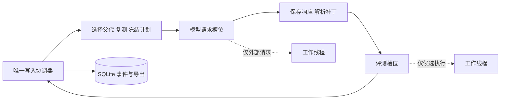

# 同一实验内的有界异步流水线

当前schema 9。这里实现的是AlphaEvolve异步控制思想的本机首版：一个协调器调度多个模型请求和评测操作。此前的 Examples.run_batch 调度多个独立实验；新的 Examples.run_async_search 在一个实验内让请求与评测重叠。模型参数保持冻结。

## 先跑离线演示

```powershell
python -X utf8 -m Examples.run_async_search --config configs/circle_packing.async.offline.json --offline-demo
```

这个命令创建新实验，用已审查的手写响应跑6代，实际执行候选与几何评测，不创建远程模型客户端。它不是模型搜索实验。夹具响应很快，演示记录中模型请求峰值可能只有1；单独的门控测试会强制两个请求重叠，并使第二个响应先提交，以验证真正并发和乱序处理。

恢复同一实验：

```powershell
python -X utf8 -m Examples.run_async_search --experiment dev_runs/exp_实际编号 --offline-demo --steps 2
python -X utf8 -m Examples.inspect_archive --experiment dev_runs/exp_实际编号
```

框架升级后应创建新实验；schema 8及更早的目录保持原样，不能修改manifest伪装兼容。所有新模块也进入实验快照。

## 调度结构与并发参数



配置新增pipeline，创建实验时展开并冻结：

```json
"pipeline": {
  "mode": "async",
  "max_inflight": 4,
  "model_concurrency": 2,
  "evaluation_concurrency": 1
}
```

- max_inflight限制处在父代准备、等待请求、模型调用、等待评测或执行中的生成任务总数，防止无限堆积已付费响应。
- model_concurrency限制同时进行的程序生成请求数。
- evaluation_concurrency限制同时进行的标准评测数，包括父代复测与子代评测。默认1；提高后可能影响当前按时间停止的数值算法，正式比较必须固定此条件。
- mode默认serial，使用原 Examples.run_search；async使用新入口。入口不允许静默切换实验模式。

本版采用有限任务集合与信号量施加背压，不是跨机工作队列。模型客户端延迟创建，初始化有线程锁；密钥只在调用端读取，仍不传入执行端。

## 为什么不让线程直接写数据库

协调器在事件循环线程持有整个实验的OS锁。工作线程只调用模型接口或run_candidate，返回后由协调器提交调用记录、评测记录、生成状态和档案。每个SQLite事务仍是同步操作，因此大量fsync可能成为吞吐瓶颈。

父代选择、编号、复测到计划提交由一条准备通道控制，避免两个任务使用同一生成序号。父代复测本身在评测线程执行，期间其他已经发出的请求和子代评测仍能推进。计划提交后，父代、参考程序、消息、模型和补丁目标不随档案变化而改变。

第二个请求可以先返回并先入库。档案按实际提交事件顺序更新，保存响应后重放同一事件序列能得到相同档案；相同随机种子无法保证另一次异步搜索得到相同事件顺序。未完成的子代不会提前提供奖励，在途调用只增加父代访问计数。

## 请求前预留，避免并发超额准入

模型调用先保存calls记录和Token预留，再交给线程。检查余额到提交预留之间没有await，两个协程不会同时使用旧余额。返回后按已报告用量更新；缺少usage或结果未知时保留预留量。它仍是估计规则，不是中转服务精确计费保证。

异步计划还在发请求前预留一次完整子代评测额度，存入生成状态reserved_child_evaluation_seconds。等待模型返回时，后续父代复测不能消耗这笔额度。子代实际开始时转为评测记录，只计一次；解析/骨架失败或确定未发送时释放。评测已开始后中断仍保守计入，不伪装成未执行。

用量中的evaluation_seconds是已开始评测的消耗或保守估计；pending_evaluation_seconds是尚未开始的子代预留，两者共同参与准入检查。

累计墙钟核算沿用保守规则，至少为控制器运行累计时间与评测/调用时间之和的较大值。因此并发重叠时间可能被多算，这不是精确吞吐计时，也不保证操作系统层面的硬截止；控制记录elapsed_seconds用于观察本次实际墙钟。未引入按阶段重叠去重的计时账本。

## 停止、错误和恢复

在实验目录创建STOP文件，或取消run_search_async协程，都会关闭新请求准入。已经开始的调用和评测继续排空并落盘后才释放实验锁。取消会在排空后向调用者传播；它不表示远程服务撤销计费。再次启动前先移除STOP。

已经有计划但尚未请求的任务变为not_sent，释放子代预留，不计入调用数、父代访问数或选择熵；它仍占用生成计划数。实际调用数以calls账本为准。请求结果未知则记uncertain，关闭准入；再次启动会拒绝自动重发。

语法、补丁或骨架失败可继续其它尝试；提供方错误、执行基础设施错误和无法提交的状态会停止准入，已经发出的其它调用仍保留各自结果。控制记录保存stop_reason、error_type以及在途/模型/评测峰值。错误响应正文不写入错误字段。

完整响应若已提交而生成状态没来得及保存，恢复会从calls补齐并离线处理。已有完整评测不会重新执行。遗留的部分评测/复核组依旧需要显式处理，不自动补跑或挑选最好结果。同一个会话不能同时启动两个异步控制器，也不能在运行时另开CLI恢复这个实验。

元指令提案和重复确认采用排空屏障：暂不补充新任务，等当前在途任务结束后沿用原有串行实现。这样便于明确预算与信用窗口，但这两类操作目前会阻塞协调器，停止响应可能要等该操作结束；它们不是独立异步节点。关闭meta/confirmation后主流水线持续补充任务。提高这些可选阶段的吞吐属于后续优化。

## 正式实验边界

2026-11-12补充：本机Docker已安装到D盘，手写种子执行和8项真实容器隔离测试均已通过（0跳过），启动方法见 docker_on_this_pc.md。异步控制器仍仅经离线夹具验证，尚未开展真实模型异步实验；本次没有付费调用。真实自动流水线要求Docker，禁止回退到本地执行。

按 [sandbox_setup.md](sandbox_setup.md) 完成实际隔离验收后，从固定镜像配置复制一个新配置，设置pipeline.mode=async并冻结并发数，再启动 Examples.run_async_search。不要修改旧实验manifest。三策略比较必须保持mode和并发参数一致，串行与异步是另一项对照，不应混排。

当前不是论文原部署的完整复现：没有跨机执行节点、租约和故障容器自动回收，也未完成大型历史增量索引。单机并发的正确性通过离线测试，不代表已证明速度收益或策略质量。

主要实现：[async_controller.py](../Evolve/async_controller.py)、[generation.py](../Evolve/generation.py)、[calls.py](../Evolve/calls.py)、[session.py](../Evolve/session.py)、[budget.py](../Evolve/budget.py)。反例与集成验证见 [test_async_pipeline.py](../tests/test_async_pipeline.py)。
