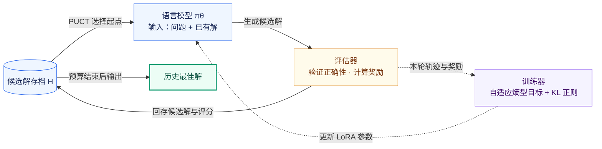

# 学习笔记

> 日期：2026-11-07 ｜ 状态：学习中

## Self-Refine

Self-Refine是2023年提出的一种方法，其核心的思想就是让LLM通过生成-反馈-改进的方式去改进LLM的文字输出

整体的过程如下图：

给出一个问题以及初始生成的提示词示例，LLM就会学习示例中的方式给出一个初始输出，初始输出还需要经过同一个LLM，通过反馈提示示例的方式，由同一个LLM给出反馈，反馈需要具体且可操作。就像下面的例子，对于一个累加函数，LLM给出的反馈中提到“这个代码太慢了，因为它使用了穷举法”这部分就是“具体”的展现，而后面的“一个更好的方式就是使用公式......”这部分则是“可操作”的体现。反馈最终会给回LLM，通过学习改进提示词示例，LLM会最终给出一个改进的输出。

通常一次的改进可能还无法取得很好的效果，所以改进的输出会继续去进行迭代，直到满足事先设定的迭代次数或者LLM从反馈中获取到了停止的信号

在这种方式中，只需要一个LLM，以及生成-反馈-改进三个部分的提示词示例。在当时，这种方式对于情感反转、回复生成以及缩写生成等基于偏好的任务取得了较好的效果，但是局限也很明显，因为这种方式只涉及到了LLM以及提示词示例，首先使用的LLM需要具备上下文学习的能力，其次使用LLM给出反馈的方式意味着对于一些LLM本身不清楚的内容无法提供有效的反馈。同时，LLM还存在幻觉问题，例如如果你想让其改进一个本身比较完善的内容时，其可能会无中生有的去找问题。

## FunSearch

FunSearch提出之时，LLM在代码生成、调试、代码竞赛以及代码性能改进上已经取得了较为明显的进展，但是为开放问题合成solve程序要求找到可验证正确的新思想对于LLM来说十分困难。LLM已经展现了它解决复杂任务的能力，但是其有时会产生的“幻觉”，给出看似合理却错误的陈述，这阻碍了其在科学发现中的使用。

FunSearch，一种将预训练LLM与系统化评估器配对的演化式流程，在极值组合学的cap set相关问题上改进了已知构造或下界，在所测试的在线装箱分布上找到了优于常用基线的启发式算法。

下图展现了FunSearch的一个基本的流程：

FunSearch使用的是一个预训练模型，没有针对目标问题额外进行微调。相比于一般的计算机搜索解的方法，FunSearch搜索的是如何求解一个问题的程序，这相比于原始解更加具有可解释性。

方法的具体实现：输入部分通常会是一个初始程序，其中有对于一个问题最关键的函数部分，其余部分则构成“骨架”，骨架部分包含用户提供的evaluate函数以及评估测试的输入。FunSearch采用一种岛屿模型的方式维护程序数据库，初始时所有的岛屿存放的都是初始程序的副本，每次从程序数据库采样时，会随机选择一个岛屿，每次采样k个程序。在岛屿的内部，是一个个经过程序的signature聚类的cluster，signature是程序在一组输入上的得分元组，元组相同的程序聚为一类。采样时先需要先选择一个cluster，选择的规则如下：

$$
P_i=\frac{\exp(s_i/T_{\mathrm{cluster}})}{\sum_{i'}\exp(s_{i'}/T_{\mathrm{cluster}})},
\qquad
T_{\mathrm{cluster}}=T_0\left(1-\frac{n\bmod N}{N}\right).
$$

其中， $`s_i`$ 表示当前cluster的聚合分数， $`T_{\mathrm{cluster}}`$ 是温度参数， $`i'`$ 遍历岛屿内包含当前cluster在内的所有cluster， $`s_{i'}`$ 是第 $`i'`$ 个cluster的分数。 $`n`$ 表示当前岛屿已登记的程序数量， $`T_0`$ 是初始温度， $`N`$ 是温度变化的周期。

从这个公式可以看出，虽然偏好于高分的cluster，但是低分的cluster也有机会被选择。在一个温度周期内，随着岛屿中程序数量的增加，温度下降，采样越来越偏向高分cluster；进入下一个周期时，温度恢复，又会增加探索的机会。这种方式可以理解为在每个周期内从“探索”逐渐偏向“利用”。选择cluster后，还需要选择cluster内部的程序，程序的选择偏好于短程序，与选择cluster类似，长的程序也有被选择的可能。

选择的程序会按分数从低到高作为不同版本放入prompt，并追加下一个版本的函数头送入LLM中。LLM给出优化的程序后送入评估器中，通过正确性检查并获得有效分数后存回原岛屿，根据signature加入已有或新建的cluster。岛屿每隔一定的周期会进行重置，原论文每4小时会清空历史最佳分数较低的一半岛屿。每个被清空的岛屿会随机选择一个存活岛屿，存入该存活岛屿的最优程序副本。

总的来说，LLM不断给出候选程序，程序数据库通过进化算法去维护候选程序，通过“岛屿”的方式，让候选程序能够维持多样性，降低过早收敛的风险，LLM偶尔冒出的一些有意思的想法得以被发现。

## AlphaEvolve

人们对使用大语言模型将发现新的高价值知识的大部分环节自动化抱有浓厚兴趣。AlphaEvolve是一个进化式编码智能体，能够显著增强LLM在开放科学问题、或者优化关键基础设施等高难度任务上的能力。

人类定义“做什么”：设定评估标准，提供初始解和可选的背景知识。AlphaEvolve 负责找出“怎么做”：提示采样器（Prompt sampler）从程序数据库（Program database）中取出带质量分数和其他反馈的程序，构造包含过往尝试与思路的丰富上下文；LLM 集成（LLMs ensemble）提出改进后的程序；评估器池（Evaluators pool）对其打分，最终得到改进后的解。

其中相比于FunSearch进化单个函数，AlphaEvolve提供（`# EVOLVE-BLOCK-START` 和 `# EVOLVE-BLOCK-END`）来进化多个代码块，其余代码构成骨架。对于提示采样部分，支持定制的需求，如显式上下文：包含待解决问题的详细信息。元提示进化：由 LLM 自己在额外的提示生成步骤中提出的指令和上下文，并像解程序一样，在单独的数据库中协同进化等。AlphaEvolve在原论文中主要用的模型为Gemini 2.0 Flash以及Gemini 2.0 Pro，其中Flash用于快速地提供多个候选，增加单位时间探索的想法数量，Pro则用于偶尔提供质量更高的候选，推进进化搜索。对于评估部分，生成的解需要执行用户的评估函数，此外还可考虑其它的机制，如可以指定难度不断增加的测试集合，只有当解在前面部分的测试集合取得足够的成果时，才会进入后续的评估，或者先进行小规模的评估再进入主要测试用例的检验。此外，对于一些评估函数很难涉及到的方面，例如程序简洁性，可以在评估函数评估的基础上使用LLM进行评估。AlphaEvolve支持在多个分数上的优化。在 AlphaEvolve 中，进化数据库实现的算法受到 MAP-Elites 算法与基于岛屿的种群模型相结合的启发。

## Test-time training to discover

TTT-discover在针对单个问题搜索候选解的同时，利用可验证奖励更新生成模型，并通过状态复用接续已有改进，最终交付预算内找到的最佳解。

对于如何使用AI让科学问题发现超出现有最佳水平的解这样一个问题，以AlphaEvolve为代表的方法通过冻结的LLM开展搜索，通过不断迭代的优化过程寻找最佳水平的解。AlphaEvolve 等演化搜索方法将既往尝试保存在缓冲区中，再通过人工设计、面向特定领域的启发式规则生成新的提示，这些提示能够帮助LLM改进先前的解，但并不更新生成模型的参数。

那么搜索过程中获得的反馈能否进一步用于更新模型，使得模型能逐渐适应当前问题，提出更高质量的候选解呢？TTT-discover在测试时使用强化学习，将针对当前问题积累的经验用于继续训练模型，使参数学习与候选解搜索共同服务于发现更好的解。

状体是改进的对象，策略 $`\pi_\theta`$ 是语言模型在给定输入后生成不同输出的概率分布， $`\theta`$ 表示模型的可训练参数。输入包括问题描述 $`d`$ 、当前候选解 $`s`$ ，以及搜索过程提供的上下文 $`c`$ 。模型从这个分布中生成动作 $`a`$ ：

$$
a\sim\pi_\theta(\cdot\mid d,s,c),
\qquad s'=f(s,a),
\qquad r=R(s').
$$

这里 $`f`$ 是环境的状态转移过程。评估器检查新状态的有效性，再给出奖励 $`r`$ 。

下文固定问题描述 $`d`$ 与上下文 $`c`$ 时，将其从策略条件中省略，简写为 $`\pi_\theta(\cdot\mid s)`$ ；一次完整生成的rollout记为 $`\tau`$ ，其评估奖励记为 $`r(\tau;s)`$ 。这里的 $`\tau`$ 指从当前起点生成的一次尝试，不是从最初候选解开始的整条搜索历史。

TTT-discover的最终目标是针对一个固定问题，在预算内寻找奖励最高的候选解。记预算 $`B`$ 内获得的候选解集合为 $`\mathcal H_B`$ ，最终输出可以写为：

$$
s^*=\arg\max_{s\in\mathcal H_B}R(s).
$$

这里的“最佳”指本次搜索找到的最好结果，并不意味着已经证明它是全局最优解。论文将找到 $`R(s)>r_{\mathrm{sota}}`$ 的状态定义为一次Discovery，其中 $`r_{\mathrm{sota}}`$ 是此前已知最佳解的奖励。

这一任务有两个特征：一是只要求适应当前问题，不要求更新后的模型泛化到其他问题；二是最终交付的是最佳候选解，策略更新是帮助寻找该解的手段。因此，即使训练后策略的平均奖励没有提高，只要它帮助搜索找到更好的候选解，也可能对最终目标有价值。当然单问题训练并不是TTT-discover独有的性质，传统强化学习同样可以针对单个任务训练。

一次循环先从存档选择起点，再由模型生成改进方案，评估后分别更新候选解存档和模型参数，随后进入下一轮。预算结束时返回历史最佳解。如下图所示：

如果每次都从同一个初始解重新生成，即使模型参数不断更新，前面已经找到的具体改进也不一定会被后面的尝试接续。状态复用则把已有解保存在存档 $`\mathcal H`$ 中，每次选取其中一个解作为新的起点。这样，某次生成的改进结果可以成为下一次改进的输入，搜索能够逐步积累，而不必在一次生成中完成全部优化。

但是，始终选择当前奖励最高的解容易让搜索集中在一小片区域；完全随机选择，又会忽略已经证明有潜力的解。TTT-discover使用一个受PUCT启发的规则，为存档中的状态计算优先级：

$$
\mathrm{score}(s)
=Q(s)+c_{\mathrm{puct}}\cdot\mathrm{scale}\cdot P(s)
\frac{\sqrt{1+T}}{1+n(s)}.
$$

其中， $`Q(s)`$ 表示以这个状态为起点直接生成的子状态中，历史上获得过的最高奖励；尚未扩展过时，使用状态自身的奖励 $`R(s)`$ 。 $`P(s)`$ 是根据状态在存档中的奖励排名计算的先验，高奖励状态获得更高的先验。 $`n(s)`$ 统计该状态及其后代被扩展的次数， $`T`$ 是总扩展次数， $`c_{\mathrm{puct}}`$ 控制探索强度， $`\mathrm{scale}`$ 是存档中的奖励范围，用于调整探索项的数值尺度。这个公式体现了“探索”和“利用”的权衡。

PUCT负责选择给模型哪个已有解，语言模型策略 $`\pi_\theta`$ 决定在这个输入下生成什么改进方案。

TTT-discover的训练目标是提高高奖励结果在更新中的影响，希望让高奖励轨迹在更新中获得更强的影响，而不只是提高整体平均表现。论文使用entropic objective（熵型目标）：

$$
J_\beta(\theta;s)
=\log\mathbb E_{\tau\sim\pi_\theta(\cdot\mid s)}
\left[\exp\big(\beta(s)r(\tau;s)\big)\right].
$$

相比直接对奖励取平均，这里先对奖励进行指数变换，使高奖励结果获得更大的权重。 $`\beta(s)>0`$ 控制这种偏向的强度，越大就越强调高奖励结果。

还需要策略将奖励权重转化为参数更新方向。对上面的目标求策略梯度，在求导时将当前选定的 $`\beta(s)`$ 视为固定值，可以得到：

$$
\nabla_\theta J_\beta(\theta;s)
=\mathbb E_{\tau\sim\pi_\theta(\cdot\mid s)}
\left[w_\beta(\tau\mid s)\nabla_\theta\log\pi_\theta(\tau\mid s)\right],
$$

$$
w_\beta(\tau\mid s)
=\frac{\exp\big(\beta(s)r(\tau;s)\big)}
{\mathbb E_{\pi_\theta(\cdot\mid s)}
\left[\exp\big(\beta(s)r(\tau;s)\big)\right]}.
$$

这个式子可以分成两部分理解： $`w_\beta`$ 根据奖励决定一条轨迹在训练中的权重， $`\nabla_\theta\log\pi_\theta(\tau\mid s)`$ 则给出改变模型参数、提高这条轨迹生成概率的方向。评估器只需要提供奖励，不需要对代码执行过程或者运行时间求导；真正反向传播的是模型对已生成token所计算的对数概率。

由于 $`\mathbb E[w_\beta]=1`$ ，可以减去一个不改变期望策略梯度的baseline，得到优势值：

$$
A_\beta(\tau\mid s)=w_\beta(\tau\mid s)-1.
$$

优势值为正的轨迹，其生成概率受到提高的推动；优势值为负的轨迹，其生成概率受到降低的推动。这里的正负由轨迹相对于当前采样分布的指数奖励权重决定，不是根据它是否已经超过已有最佳解来划分。因此，即使本轮还没有找到新的最佳解，也仍然可以产生训练信号。

对于固定 $`\beta`$ 不容易适用于整个搜索过程，早期候选解的奖励差距可能很大，较大的 $`\beta`$ 会让少数轨迹支配更新；后期改进越来越小，较小的 $`\beta`$ 又可能无法有效区分这些微小差异。因此，论文根据每个初始状态对应的一组rollout，自适应地选择 $`\beta(s)`$ 。

假设从同一个状态生成 $`N`$ 条轨迹，奖励为 $`r_1,\ldots,r_N`$ 。在这一批已采到的样本上，先定义均匀分布 $`u(j)=1/N`$ ，以及由指数奖励形成的重加权分布：

$$
q_\beta(j)=\frac{e^{\beta r_j}}{\sum_{k=1}^{N}e^{\beta r_k}}.
$$

这里 $`q_\beta(j)`$ 表示第 $`j`$ 条已采样轨迹在奖励重加权后占多少比例，不是模型原本生成这条轨迹的概率。论文通过二分搜索调整 $`\beta`$ ，使其满足权重集中程度的约束：

$$
D_{\mathrm{KL}}(q_\beta\|u)
=\sum_{j=1}^{N}q_\beta(j)\log\big(Nq_\beta(j)\big)
=\ln2.
$$

这样， $`\beta`$ 会随当前奖励分布的尺度变化，既偏好高奖励轨迹，又避免权重过度集中。奖励完全相同时，指数重加权无法产生差异，增大 $`\beta`$ 也不能凭空产生区分信号。这个KL约束控制的是辅助分布的权重集中程度，并不直接保证神经网络更新前后的策略KL恰好等于 $`\ln2`$ 。

KL用于抑制策略偏离初始模型过多。另外，论文还在训练优势中加入相对于测试时训练初始策略 $`\pi_{\theta_0}`$ 的KL惩罚，形式写为：

$$
A(\tau;s)
=w_{\beta(s)}(\tau\mid s)-1
-\lambda\log\frac{\pi_\theta(\tau\mid s)}{\pi_{\theta_0}(\tau\mid s)}.
$$

选择 $`\beta`$ 时的KL控制当前批次中的奖励重加权分布；这里的KL正则抑制策略偏离初始模型过多。两者分别作用于样本权重与生成策略，不能混为一谈。

论文主要实现使用gpt-oss-120b，LoRA rank为32，共进行50次训练更新。

每次更新前，先通过PUCT从存档选择8组起点，每组共享相同的初始状态与上下文，分别生成64条rollout，共得到512条新轨迹。

在存档维护上，每个被扩展的父状态只将奖励最高的两个子状态加入存档，再按奖励保留全局前1000个状态，同时始终保留初始种子状态。这意味着评估过的解不会全部永久进入后续可选的存档。

选择同一批次的起点时，论文还会排除已经选中状态的祖先与后代，以减少多个起点集中在同一谱系上的情况，子状态奖励用于更新直接父状态的最高子状态奖励统计。

在实际训练中，可以将对应的策略梯度写成最小化下面的损失的形式：

$$
\mathcal L(\theta)
=-\frac1N\sum_{j=1}^{N}
\mathrm{stopgrad}(A_j)
\log\pi_\theta(\tau_j\mid s).
$$

这里的 $`\mathrm{stopgrad}`$ 表示在更新中把已经算出的优势值当作固定系数，而不是继续对优势值本身求导。这个式子用于说明奖励如何变成参数更新。

TTT-discover实际通过LoRA更新参数：预训练模型的基础权重保持冻结，训练的是附加的低秩参数。训练器根据轨迹、奖励和模型的对数概率计算损失，再通过反向传播和优化器更新这些LoRA参数。

新轨迹经过执行和评估后，一方面按存档规则更新候选解与PUCT统计量，另一方面在各组内计算自适应 $`\beta`$ 和优势值，将整批512条新轨迹用于一次梯度更新。更新后的模型与存档再进入下一轮。

## Frontier-Eng

在工程领域中一个想法从概念走向实际，通常会有这样一个循环：定义需求，根据需求构建原型，原型在约束下进行测试，再加以改进。尽管第一次创造出可行的解决方法很重要，但是在真实约束下对可行设计进行系统性的迭代改进才是最终获取大部分价值所在。仅仅只是做对一件事是不够的，还需要越做越好。

当前的AI智能体基准很大程度上仍然面向从0到1，结果为二元的任务，例如网络搜索过程中检索确定的答案或者生成程序。在真正的工程中，很少仅仅是从零到产生一个正确的产物的这样的过程，而是需要对一个初始的可行解持续在特定领域下进行迭代优化的过程，此外很多工程优化问题的全局最优解未知，或者难以在有限预算内求得，所以问题的关键不是“解是否正确”而是“智能体在预算中能找到多好的解”。

从 Self-Refine 的自我反馈，到 FunSearch、AlphaEvolve 的“由LLM提议结合自动评估器筛选”的方法，证明了 LLM 具备迭代改进代码的潜力。这些方法已经涉及数学发现、算法优化以及数据中心调度等工程应用，但仍缺少跨多个工程领域的统一评测。

Frontier-Eng包含47个任务，覆盖计算与量子信息、运筹学与决策科学、机器人、控制与能源系统、光学与通信系统，以及物理科学与工程设计五个工程类别，任务来源包括成熟的工程竞赛、学术基准套件、经典课程作业、工业仿真工具以及领域专家的原创贡献。每个任务都在统一的面向智能体的接口之后封装了一个可编辑产物、一个带有可行性硬约束的可执行验证器、一个由贡献者提供的可行基线以及轻量级元数据。为防止奖励作弊（reward hacking），所有评估器和参考数据均被标记为只读：评分由独立、冻结的验证器完成，智能体无法对其进行修改。候选方案在沙箱化的临时目录中执行，输出指标从验证器生成的日志中解析得到，而非由智能体自行报告。

具体的实现过程中，其将任务描述为一个三元组，包含上下文，初始解，以及评估器。上下文包含智能体可以读取但不能修改的全部内容，如问题说明，约束描述，数据或文档等等，初始解是一个可行方案，用于迭代改进。评估器则是一个独立于智能体之外的函数，用于接收候选解并返回两个信号，分别是可行性指示以及标量得分，前者用于判断产物是否满足全部硬约束，只有在满足全部硬约束时，得分才有意义并计入最佳成绩。对于一个问题，在每一步上智能体都可以利用上下文以及这一步之前全部尝试的历史，实际上尝试的历史是通过搜索策略选择部分给予上下文，然后提出一个新的候选解，然后评估器对这个候选解返回结果，每次都会消耗步数，包括不可行的尝试，目标就是最大化步数预算内的最佳可行得分。流程如下：

这里的搜索策略并没固定，可以选择多种进化算法等方式。搜索策略不同，提交给LLM的历史尝试也有所差异，最后的结果自然也有所不同。

对于评估部分，由于任务的多样性和单位的不一致性，论文采用了平均排名的形式去避免单位不一致导致的差异，对于一个方法m在不同的任务上都会存在不同的排名。

$$
R_m=\frac{1}{N}\sum_{i=1}^{N}\mathrm{rank}_{i,m}.
$$

这里 $`N`$ 是任务数，每个任务按照各方法的最佳可行分数从高到低排名，并列取平均名次，平均排名越低越好。

由于排名丢失了幅度信息，为了恢复幅度信息论文使用了分布分析的方式。为处理负分，论文对每个任务的所有方法统一平移，用当前方法的最佳可行分数减去该任务所有方法各自最佳可行分数中的最小值，再加一得到正的值，然后由此可以去计算性能比率：

$$
\tilde s_{i,m}=s^\star_{i,m}-\min_{m'}s^\star_{i,m'}+1,
\qquad
\rho_{i,m}=\frac{\tilde s_{i,\mathrm{best}}}{\tilde s_{i,m}}.
$$

这里分子是对于一个任务的多个方法中，平移分数最高的，分母是当前方法的平移分数，结果表示当前方法在平移后的分数尺度上，距离参与比较方法中的最佳成绩有多远。比如比率为2，只表示平移后得分是最佳值的一半，不表示原始工程性能只有一半，也不表示与理论最优的差距。

性能分布曲线：

$$
P_m(\alpha)=\frac{1}{N}\left|\{i:\rho_{i,m}\le\alpha\}\right|,
\qquad \alpha\ge1.
$$

当 $`\alpha`$ 取1时，表示这个方法有多少比例的任务取得参与比较方法中的最优成绩，包括并列。

胜率：

$$
\mathrm{WinRate}_m=\frac{1}{N}\sum_{i=1}^{N}\mathbf 1\left(s^\star_{i,m}>s_{i,0}\right).
$$

最佳可行分数严格超过初始方案的任务比率。

Frontier-Eng对多个大模型展开了评测。在GPT-OSS-120B和OpenEvolve对47个任务各运行500次迭代的实验中，随着优化的进行，改进事件的频率和单次的幅度总体越来越小。下图左侧横轴是迭代次数 $`t`$ ，右侧横轴是轨迹内第几次改进 $`k`$ 。

在GPT-OSS-120B和OpenEvolve的另一个10任务子集实验中，固定总评估次数为256次，增加单次搜索运行的深度比增加独立搜索运行的数量更加有效，如下图。这里的预算是评估次数，不是运行时间。

## 参考链接

- [Self-Refine](https://arxiv.org/html/2303.17651v2)
- [FunSearch](https://www.nature.com/articles/s41586-023-06924-6)
- [AlphaEvolve](https://arxiv.org/html/2506.13131v1)
- [Frontier-Eng（v2）](https://arxiv.org/html/2604.12290v2)
