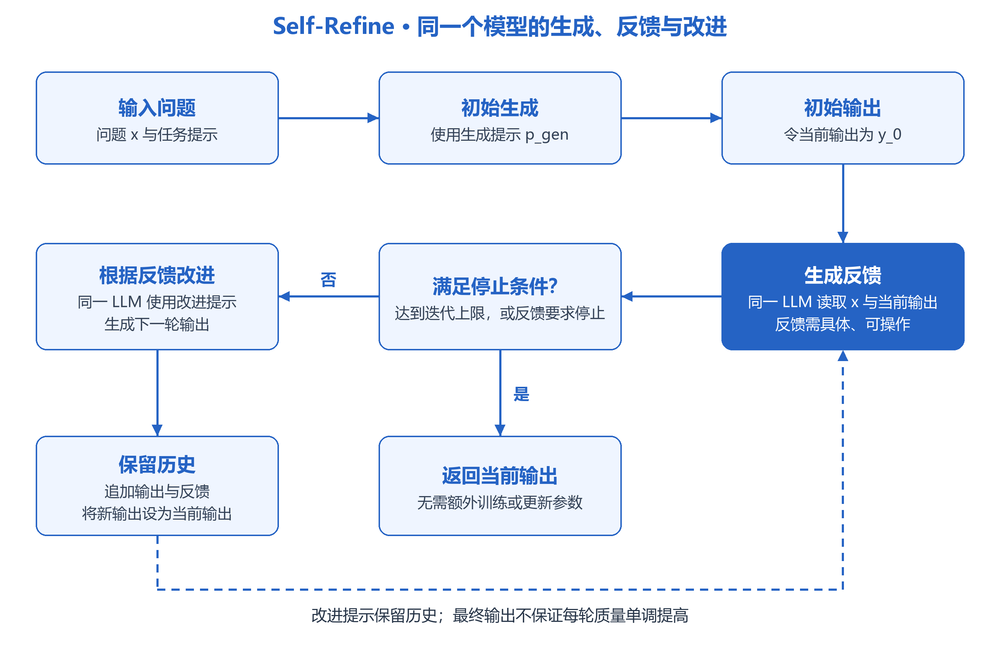
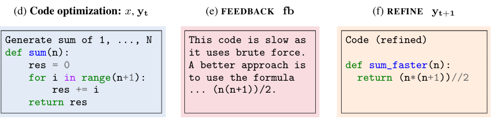
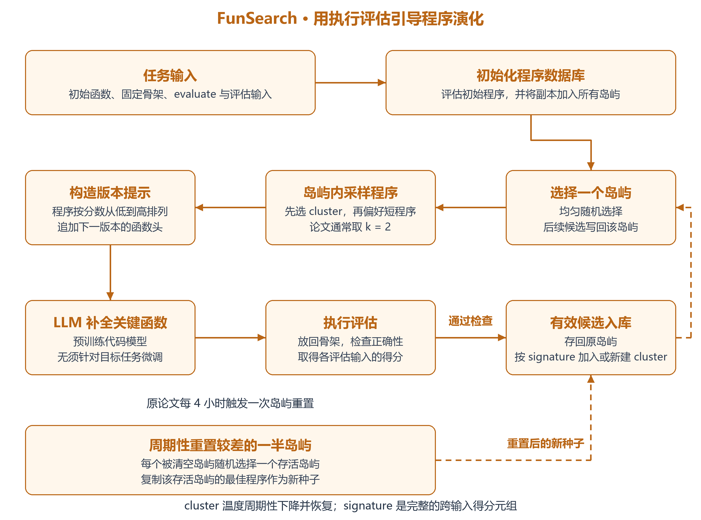
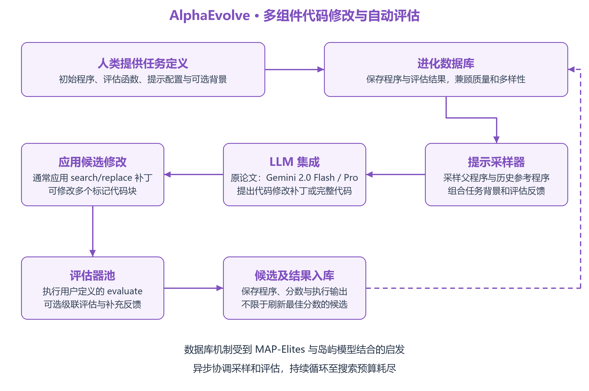
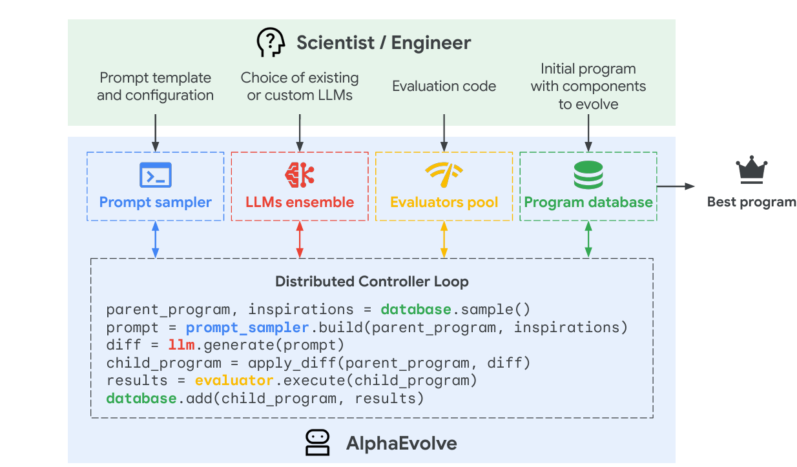
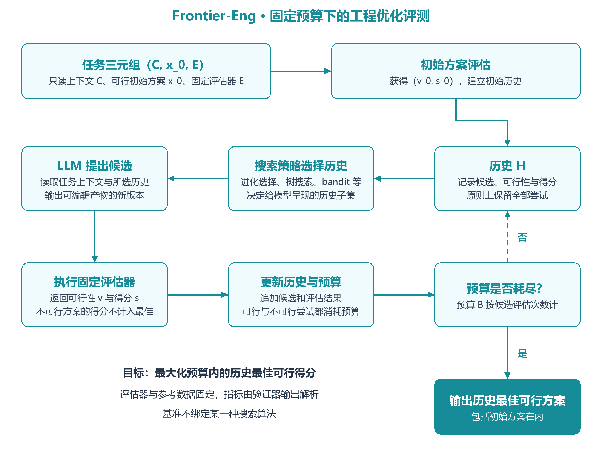
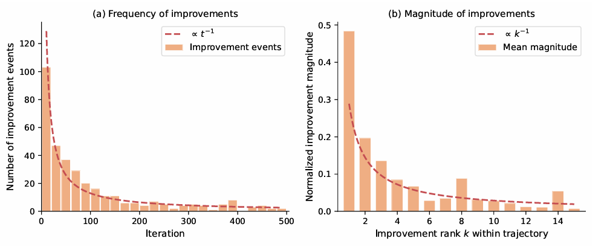
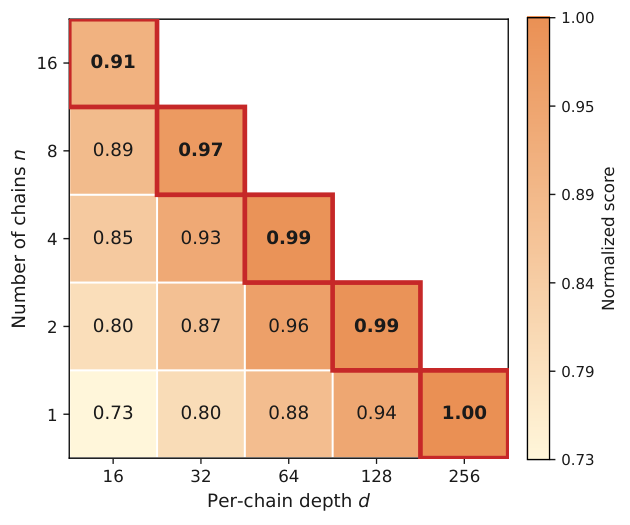

# 生成式优化笔记

> 日期：2026-11-07 ｜ 状态：学习中

## Self-Refine

Self-Refine是2023年提出的一种方法，其核心的思想就是让LLM通过生成-反馈-改进的方式去改进LLM的文字输出

整体的过程如下图：

给出一个问题以及初始生成的提示词示例，LLM就会学习示例中的方式给出一个初始输出，初始输出还需要经过同一个LLM，通过反馈提示示例的方式，由同一个LLM给出反馈，反馈需要具体且可操作。就像下面的例子，对于一个累加函数，LLM给出的反馈中提到“这个代码太慢了，因为它使用了穷举法”这部分就是“具体”的展现，而后面的“一个更好的方式就是使用公式......”这部分则是“可操作”的体现。反馈最终会给回LLM，通过学习改进提示词示例，LLM会最终给出一个改进的输出。

通常一次的改进可能还无法取得很好的效果，所以改进的输出会继续去进行迭代，直到满足事先设定的迭代次数或者LLM从反馈中获取到了停止的信号

在这种方式中，只需要一个LLM，以及生成-反馈-改进三个部分的提示词示例。在当时，这种方式对于情感反转、回复生成以及缩写生成等基于偏好的任务取得了较好的效果，但是局限也很明显，因为这种方式只涉及到了LLM以及提示词示例，首先使用的LLM需要具备上下文学习的能力，其次使用LLM给出反馈的方式意味着对于一些LLM本身不清楚的内容无法提供有效的反馈。同时，LLM还存在幻觉问题，例如如果你想让其改进一个本身比较完善的内容时，其可能会无中生有的去找问题。

## FunSearch

FunSearch提出之时，LLM在代码生成、调试、代码竞赛以及代码性能改进上已经取得了较为明显的进展，但是为开放问题合成solve程序要求找到可验证正确的新思想对于LLM来说十分困难。LLM已经展现了它解决复杂任务的能力，但是其有时会产生的“幻觉”，给出看似合理却错误的陈述，这阻碍了其在科学发现中的使用。

FunSearch，一种将预训练LLM与系统化评估器配对的演化式流程，在极值组合学的cap set相关问题上改进了已知构造或下界，在所测试的在线装箱分布上找到了优于常用基线的启发式算法。

下图展现了FunSearch的一个基本的流程：

FunSearch使用的是一个预训练模型，没有针对目标问题额外进行微调。相比于一般的计算机搜索解的方法，FunSearch搜索的是如何求解一个问题的程序，这相比于原始解更加具有可解释性。

方法的具体实现：输入部分通常会是一个初始程序，其中有对于一个问题最关键的函数部分，其余部分则构成“骨架”，骨架部分包含用户提供的evaluate函数以及评估测试的输入。FunSearch采用一种岛屿模型的方式维护程序数据库，初始时所有的岛屿存放的都是初始程序的副本，每次从程序数据库采样时，会随机选择一个岛屿，每次采样k个程序。在岛屿的内部，是一个个经过程序的signature聚类的cluster，signature是程序在一组输入上的得分元组，元组相同的程序聚为一类。采样时先需要先选择一个cluster，选择的规则如下：

$$
P_i=\frac{\exp(s_i/T_{\mathrm{cluster}})}{\sum_{i'}\exp(s_{i'}/T_{\mathrm{cluster}})},
\qquad
T_{\mathrm{cluster}}=T_0\left(1-\frac{n\bmod N}{N}\right).
$$

其中， $`s_i`$ 表示当前cluster的聚合分数， $`T_{\mathrm{cluster}}`$ 是温度参数， $`i'`$ 遍历岛屿内包含当前cluster在内的所有cluster， $`s_{i'}`$ 是第 $`i'`$ 个cluster的分数。 $`n`$ 表示当前岛屿已登记的程序数量， $`T_0`$ 是初始温度， $`N`$ 是温度变化的周期。

从这个公式可以看出，虽然偏好于高分的cluster，但是低分的cluster也有机会被选择。在一个温度周期内，随着岛屿中程序数量的增加，温度下降，采样越来越偏向高分cluster；进入下一个周期时，温度恢复，又会增加探索的机会。这种方式可以理解为在每个周期内从“探索”逐渐偏向“利用”。选择cluster后，还需要选择cluster内部的程序，程序的选择偏好于短程序，与选择cluster类似，长的程序也有被选择的可能。

选择的程序会按分数从低到高作为不同版本放入prompt，并追加下一个版本的函数头送入LLM中。LLM给出优化的程序后送入评估器中，通过正确性检查并获得有效分数后存回原岛屿，根据signature加入已有或新建的cluster。岛屿每隔一定的周期会进行重置，原论文每4小时会清空历史最佳分数较低的一半岛屿。每个被清空的岛屿会随机选择一个存活岛屿，存入该存活岛屿的最优程序副本。

总的来说，LLM不断给出候选程序，程序数据库通过进化算法去维护候选程序，通过“岛屿”的方式，让候选程序能够维持多样性，降低过早收敛的风险，LLM偶尔冒出的一些有意思的想法得以被发现。

## AlphaEvolve

人们对使用大语言模型将发现新的高价值知识的大部分环节自动化抱有浓厚兴趣。AlphaEvolve是一个进化式编码智能体，能够显著增强LLM在开放科学问题、或者优化关键基础设施等高难度任务上的能力。

人类定义“做什么”：设定评估标准，提供初始解和可选的背景知识。AlphaEvolve 负责找出“怎么做”：提示采样器（Prompt sampler）从程序数据库（Program database）中取出带质量分数和其他反馈的程序，构造包含过往尝试与思路的丰富上下文；LLM 集成（LLMs ensemble）提出改进后的程序；评估器池（Evaluators pool）对其打分，最终得到改进后的解。

其中相比于FunSearch进化单个函数，AlphaEvolve提供（`# EVOLVE-BLOCK-START` 和 `# EVOLVE-BLOCK-END`）来进化多个代码块，其余代码构成骨架。对于提示采样部分，支持定制的需求，如显式上下文：包含待解决问题的详细信息。元提示进化：由 LLM 自己在额外的提示生成步骤中提出的指令和上下文，并像解程序一样，在单独的数据库中协同进化等。AlphaEvolve在原论文中主要用的模型为Gemini 2.0 Flash以及Gemini 2.0 Pro，其中Flash用于快速地提供多个候选，增加单位时间探索的想法数量，Pro则用于偶尔提供质量更高的候选，推进进化搜索。对于评估部分，生成的解需要执行用户的评估函数，此外还可考虑其它的机制，如可以指定难度不断增加的测试集合，只有当解在前面部分的测试集合取得足够的成果时，才会进入后续的评估，或者先进行小规模的评估再进入主要测试用例的检验。此外，对于一些评估函数很难涉及到的方面，例如程序简洁性，可以在评估函数评估的基础上使用LLM进行评估。AlphaEvolve支持在多个分数上的优化。在 AlphaEvolve 中，进化数据库实现的算法受到 MAP-Elites 算法与基于岛屿的种群模型相结合的启发。

## Frontier-Eng

在工程领域中一个想法从概念走向实际，通常会有这样一个循环：定义需求，根据需求构建原型，原型在约束下进行测试，再加以改进。尽管第一次创造出可行的解决方法很重要，但是在真实约束下对可行设计进行系统性的迭代改进才是最终获取大部分价值所在。仅仅只是做对一件事是不够的，还需要越做越好。

当前的AI智能体基准很大程度上仍然面向从0到1，结果为二元的任务，例如网络搜索过程中检索确定的答案或者生成程序。在真正的工程中，很少仅仅是从零到产生一个正确的产物的这样的过程，而是需要对一个初始的可行解持续在特定领域下进行迭代优化的过程，此外很多工程优化问题的全局最优解未知，或者难以在有限预算内求得，所以问题的关键不是“解是否正确”而是“智能体在预算中能找到多好的解”。

从 Self-Refine 的自我反馈，到 FunSearch、AlphaEvolve 的“由LLM提议结合自动评估器筛选”的方法，证明了 LLM 具备迭代改进代码的潜力。这些方法已经涉及数学发现、算法优化以及数据中心调度等工程应用，但仍缺少跨多个工程领域的统一评测。

Frontier-Eng包含47个任务，覆盖计算与量子信息、运筹学与决策科学、机器人、控制与能源系统、光学与通信系统，以及物理科学与工程设计五个工程类别，任务来源包括成熟的工程竞赛、学术基准套件、经典课程作业、工业仿真工具以及领域专家的原创贡献。每个任务都在统一的面向智能体的接口之后封装了一个可编辑产物、一个带有可行性硬约束的可执行验证器、一个由贡献者提供的可行基线以及轻量级元数据。为防止奖励作弊（reward hacking），所有评估器和参考数据均被标记为只读：评分由独立、冻结的验证器完成，智能体无法对其进行修改。候选方案在沙箱化的临时目录中执行，输出指标从验证器生成的日志中解析得到，而非由智能体自行报告。

具体的实现过程中，其将任务描述为一个三元组，包含上下文，初始解，以及评估器。上下文包含智能体可以读取但不能修改的全部内容，如问题说明，约束描述，数据或文档等等，初始解是一个可行方案，用于迭代改进。评估器则是一个独立于智能体之外的函数，用于接收候选解并返回两个信号，分别是可行性指示以及标量得分，前者用于判断产物是否满足全部硬约束，只有在满足全部硬约束时，得分才有意义并计入最佳成绩。对于一个问题，在每一步上智能体都可以利用上下文以及这一步之前全部尝试的历史，实际上尝试的历史是通过搜索策略选择部分给予上下文，然后提出一个新的候选解，然后评估器对这个候选解返回结果，每次都会消耗步数，包括不可行的尝试，目标就是最大化步数预算内的最佳可行得分。流程如下：

这里的搜索策略并没固定，可以选择多种进化算法等方式。搜索策略不同，提交给LLM的历史尝试也有所差异，最后的结果自然也有所不同。

对于评估部分，由于任务的多样性和单位的不一致性，论文采用了平均排名的形式去避免单位不一致导致的差异，对于一个方法m在不同的任务上都会存在不同的排名。

$$
R_m=\frac{1}{N}\sum_{i=1}^{N}\mathrm{rank}_{i,m}.
$$

这里 $`N`$ 是任务数，每个任务按照各方法的最佳可行分数从高到低排名，并列取平均名次，平均排名越低越好。

由于排名丢失了幅度信息，为了恢复幅度信息论文使用了分布分析的方式。为处理负分，论文v2对每个任务的所有方法统一平移，用当前方法的最佳可行分数减去该任务所有方法各自最佳可行分数中的最小值，再加一得到正的值，然后由此可以去计算性能比率：

$$
\tilde s_{i,m}=s^\star_{i,m}-\min_{m'}s^\star_{i,m'}+1,
\qquad
\rho_{i,m}=\frac{\tilde s_{i,\mathrm{best}}}{\tilde s_{i,m}}.
$$

这里分子是对于一个任务的多个方法中，平移分数最高的，分母是当前方法的平移分数，结果表示当前方法在平移后的分数尺度上，距离参与比较方法中的最佳成绩有多远。比如比率为2，只表示平移后得分是最佳值的一半，不表示原始工程性能只有一半，也不表示与理论最优的差距。

性能分布曲线：

$$
P_m(\alpha)=\frac{1}{N}\left|\{i:\rho_{i,m}\le\alpha\}\right|,
\qquad \alpha\ge1.
$$

当 $`\alpha`$ 取1时，表示这个方法有多少比例的任务取得参与比较方法中的最优成绩，包括并列。

胜率：

$$
\mathrm{WinRate}_m=\frac{1}{N}\sum_{i=1}^{N}\mathbf 1\left(s^\star_{i,m}>s_{i,0}\right).
$$

最佳可行分数严格超过初始方案的任务比率。

Frontier-Eng对多个大模型展开了评测。在GPT-OSS-120B和OpenEvolve对47个任务各运行500次迭代的实验中，随着优化的进行，改进事件的频率和单次的幅度总体越来越小。下图左侧横轴是迭代次数 $`t`$ ，右侧横轴是轨迹内第几次改进 $`k`$ ，这是统计趋势，并不代表每次改进都严格递减。

在GPT-OSS-120B和OpenEvolve的另一个10任务子集实验中，固定总评估次数为256次，增加单次搜索运行的深度比增加独立搜索运行的数量更加有效，如下图。这里的预算是评估次数，不是运行时间。

## Test-time training to discover

对于如何使用AI让科学问题发现超出现有最佳水平的解这样一个问题，以AlphaEvolve为代表的方法通过冻结的LLM开展搜索，通过不断迭代的优化过程寻找最佳水平的解。TTT-discover在测试时使用强化学习，不仅仅是为了搜索最佳水平的解，同时想让LLM在针对测试问题时积累的经验继续训练。

TTT-discover的目标并不追求提高大量解的平均质量，也不要求泛化到其它问题，而是在当前问题上找到一个极其出色的解。TTT-discover所用的强化学习方式和传统的强化学习也有所不同，

## 参考链接

- [Self-Refine](https://arxiv.org/html/2303.17651v2)
- [FunSearch](https://www.nature.com/articles/s41586-023-06924-6)
- [AlphaEvolve](https://arxiv.org/html/2506.13131v1)
- [Frontier-Eng（v2）](https://arxiv.org/html/2604.12290v2)
